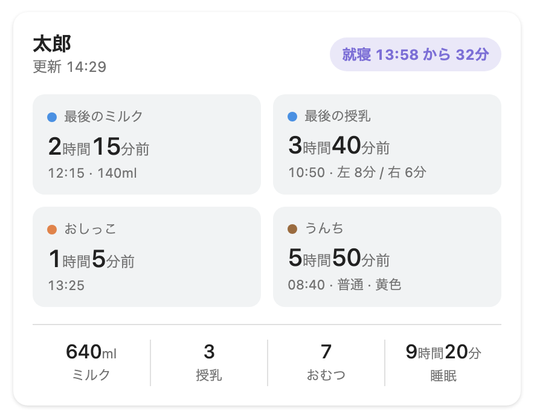
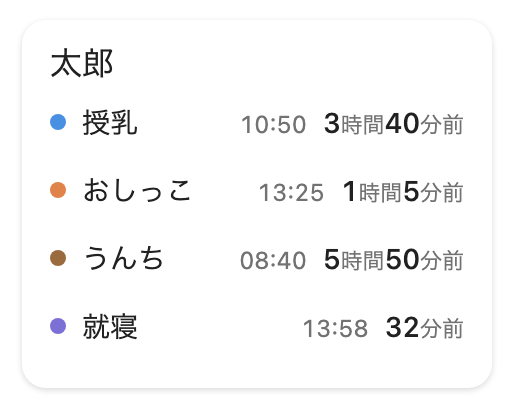
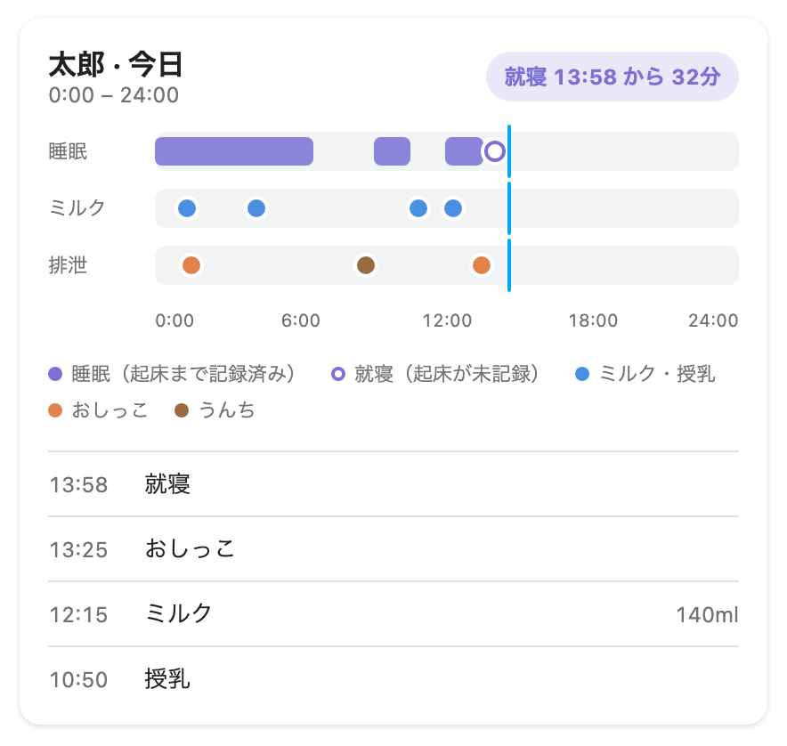
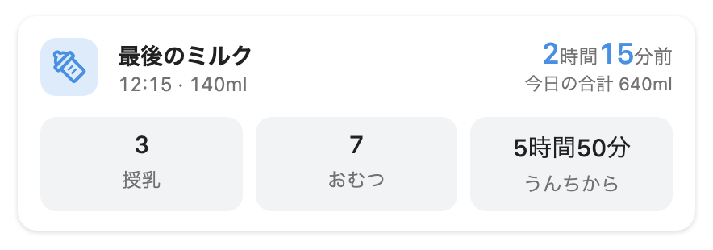

# ha-piyolog

[](https://github.com/s4k4tech/ha-piyolog/releases)
[](https://github.com/s4k4tech/ha-piyolog/actions/workflows/ci.yml)
[](https://github.com/s4k4tech/ha-piyolog/blob/main/LICENSE)
[](https://hacs.xyz)

[English](https://github.com/s4k4tech/ha-piyolog/blob/main/README.md) | 日本語

育児記録アプリ[ぴよログ](https://www.piyolog.com/)のデータフィードを読み込む、Home Assistant 用のインテグレーションとダッシュボードカードです。

> **非公式プロジェクトです。** ぴよログとは無関係で、公認・提携を受けていません。



*サマリーカードの表示例（サンプルデータ）。ほかのカードは[ダッシュボードカード](#ダッシュボードカード)にあります。*

## 目次

- [特長](#特長)
- [必要なもの](#必要なもの)
- [インストール](#インストール)
- [セットアップ](#セットアップ)
- [ダッシュボードカード](#ダッシュボードカード)
- [センサー](#センサー)
- [オートメーションの例](#オートメーションの例)
- [トラブルシューティング](#トラブルシューティング)
- [制限](#制限)
- [セキュリティとプライバシー](#セキュリティとプライバシー)
- [開発](#開発)

## 特長

- ぴよログの[データフィード](https://www.piyolog.com/app/piyolog/data_feed/en/index.html)を読み込み、記録を Home Assistant のセンサーとして公開します。
- 最後のミルク、授乳、おしっこ、うんち、睡眠の記録と、そこからの経過時間をひと目で確認できます。
- サマリー、リスト、タイムライン、コンパクトの 4 種類のカード。表示する項目と並び順を選べます。
- カードはインテグレーションが配信するため、ダッシュボードのリソース追加は不要です。
- Home Assistant のライト／ダークテーマに従い、日本語と英語に対応しています。
- 表示するのは、ぴよログに記録された内容と、その単純な集計（回数、合計、経過時間）だけです。次のミルクの時刻などの予測はせず、「ねんね中」とも表示しません。

## 必要なもの

- データフィードを作成できるぴよログのアカウント（アカウント管理者）。
- Home Assistant 2025.4 以降。Home Assistant 2026.10 で動作を確認し、自動テストは 2025.4 に対して実行しています。
- 無料プランのフィードは 24 時間分です。このインテグレーションにはそれで足ります。それより長い期間は、ぴよログのプレミアムが必要です。

## インストール

### HACS（カスタムリポジトリ）

1. HACS のメニューから **Custom repositories** を開きます。
2. `https://github.com/s4k4tech/ha-piyolog` を **Integration** として追加します。
3. **PiyoLog** をダウンロードし、Home Assistant を再起動します。

### 手動

`custom_components/piyolog` を Home Assistant の `custom_components` フォルダにコピーして再起動します。

## セットアップ

1. ぴよログでデータフィードを作成し、URL をコピーします。
2. Home Assistant の **設定 → デバイスとサービス → 統合を追加 → PiyoLog** を開きます。
3. 子どもの名前とフィード URL を入力します。名前はぴよログから取得できないため、ここで入力します。
4. ブラウザのタブを一度リロードします。カードが読み込まれます。

フィードごとに 1 件ずつ追加します。更新間隔（初期値 5 分、最短 1 分）は統合のオプションで変更できます。

## ダッシュボードカード

ダッシュボードの編集画面で「PiyoLog」を検索して追加するか、YAML で書きます。ビジュアルエディタで、デバイスの選択と項目の並べ替えができます。下の画像はサンプルデータです。

どのカードにも、次のオプションがあります。

```yaml
type: custom:piyolog-summary-card   # カードの種類（下を参照）
device_id: <デバイス ID>            # ビジュアルエディタで選択できます
name: 太郎                          # 省略可。省略するとデバイス名
```

PiyoLog のデバイスが 1 つだけなら、`device_id` は省略できます。

「2時間15分前」のような経過時間は、記録の時刻をもとにブラウザ上で計算します。睡眠は、最後の就寝または起床の記録を「就寝 13:58 から 32分」の形で表示します。「ねんね中」とは表示しません。

下の項目リストは、書いた順に表示されます。省略するとすべて表示、`[]` にするとその部分を非表示にします。存在しない項目名を書くと、カードに設定エラーが表示されます。

### サマリーカード

`custom:piyolog-summary-card`


ミルク・授乳・おしっこ・うんちからの経過時間、今日の合計、最後の睡眠記録を表示します。

| オプション | 項目 |
|---|---|
| `tiles` | `formula`, `breastfeeding`, `pee`, `poop` |
| `totals` | `formula`, `breastfeeding`, `diapers`, `sleep` |

```yaml
type: custom:piyolog-summary-card
tiles: [poop, pee, formula]
totals: [formula, sleep]
```

### リストカード

`custom:piyolog-list-card`



最新の記録を 1 行ずつ並べる、幅の狭いカードです。初期表示は、授乳・おしっこ・うんち・睡眠です。

| オプション | 項目 |
|---|---|
| `items` | `breastfeeding`, `pee`, `poop`, `sleep`, `formula`, `today_formula`, `today_breastfeeding`, `today_diapers`, `today_sleep`（初期値は先頭の 4 つ） |

セクション表示のダッシュボードでは、幅 3 列、高さ 3 行です。Home Assistant のエンティティカードの隣にそろって収まります。項目が 4 つを超えると、高さが増えます。大きさを変えたいときは、Home Assistant の `grid_options` で上書きできます。

```yaml
type: custom:piyolog-list-card
items: [breastfeeding, pee, poop, sleep]
grid_options:
  columns: 6
```

### タイムラインカード

`custom:piyolog-timeline-card`



今日の睡眠・授乳・おむつの記録の時系列と、最新の記録を表示します。

| オプション | 項目 |
|---|---|
| `rows` | `sleep`, `milk`, `diaper` |
| `legend` | `true` / `false`（凡例） |
| `log` | `true` / `false`（最近の記録） |

```yaml
type: custom:piyolog-timeline-card
rows: [diaper, sleep]
legend: false
```

### コンパクトカード

`custom:piyolog-compact-card`

ミルク（`kind: formula`、初期値）または睡眠（`kind: sleep`）を 1 行で表示します。




| オプション | 項目 |
|---|---|
| `kind` | `formula` または `sleep` |
| `quick` | `breastfeeding`, `diapers`, `poop_since`（`kind: formula` のとき） |

```yaml
type: custom:piyolog-compact-card
kind: formula
quick: [poop_since, diapers]
```

## センサー

フィード 1 件が 1 つのデバイスになり、次のセンサーができます。

| センサー | 内容 |
|---|---|
| 最後のミルク | 最後のミルクの記録時刻。属性 `amount_ml` |
| 最後の授乳 | 最後の授乳の記録時刻。属性 `left_seconds`、`right_seconds`、`last_side`、`amount_ml` |
| 最後のおしっこ | 最後のおしっこの記録時刻 |
| 最後のうんち | 最後のうんちの記録時刻。属性 `amount`、`hardness`、`color` |
| 最後の就寝記録 | 最後の Sleep の記録時刻 |
| 最後の起床記録 | 最後の WakeUp の記録時刻 |
| 今日のミルク量 | 0 時からのミルク量の合計（ml）。量のない記録は数えません |
| 今日の授乳回数 | 0 時からの授乳の記録数 |
| 今日のおむつ回数 | 0 時からのおしっことうんちの記録数 |
| 今日の睡眠時間 | 0 時からの、確定した睡眠区間の合計 |
| タイムライン | 今日の記録。カードが使います（診断用） |
| 最終更新 | ぴよログがデータを生成した時刻（診断用） |

ぴよログに記録がない属性は、0 で埋めずに省きます。メモは公開しません。

### 睡眠の計算

ぴよログは睡眠時間を提供しません。Sleep の直後に WakeUp が続く場合だけを睡眠区間として数えます。起床の記録がないときは、その区間を数えず、最後の記録をそのまま表示します。子どもが寝ているとは判断しません。

### 「ミルク」に数える記録

`Formula`（ミルク）の記録だけです。搾母乳、搾乳、飲み物は含みません。

## オートメーションの例

ミルクの記録が 4 時間ないときに通知する例です（経過時間の単純な判定で、予測ではありません）。

```yaml
triggers:
  - trigger: template
    value_template: >
      {{ (now() - states('sensor.taro_last_formula') | as_datetime).total_seconds() > 4 * 3600 }}
actions:
  - action: notify.notify
    data:
      message: ミルクの記録が 4 時間ありません。
```

`sensor.taro_last_formula` は、自分のエンティティ ID に置き換えてください。エンティティ ID は、設定 → デバイスとサービス → エンティティで確認できます。

## トラブルシューティング

- **カードが表示されない、または「カスタム要素が存在しません」と出る:** インストールや更新のあとに、ブラウザのタブをハードリロードしてください。壁掛けのタブレットや Fully Kiosk Browser のようなキオスクアプリは、古いページを保持しているため、キャッシュも消してください。
- **セットアップで「フィードが見つかりません」と出る:** URL が最後まで入力されているか、ぴよログでフィードが無効にされていないか、確認してください。
- **値が古い:** ぴよログはフィードを 1〜15 分キャッシュします。[制限](#制限)を参照してください。
- **再認証を求められる:** フィードが繰り返し 404 を返しています。新しいフィードを作成して、その URL を入力してください。
- **ログを共有するとき:** フィード URL が含まれていないか確認してください。このインテグレーションはログに URL を出しません。

## 制限

- ぴよログはフィードを 1〜15 分キャッシュするため、記録の反映が遅れることがあります。
- フィードはスナップショットです。削除した記録がキャッシュ更新まで残ることがあります。
- 「今日」は Home Assistant のタイムゾーンで決まります。
- 24 時間フィードには直近 24 時間分しかありません。「今日」の合計は、必ずその範囲に収まります。
- フィードを読むだけです。ぴよログに書き込むことはありません。

## セキュリティとプライバシー

フィード URL には秘密が含まれ、認証情報として働きます。知っている人は誰でもフィードを読めます。

- 共有したり、リポジトリにコミットしたりしないでください。
- インテグレーションは URL を設定エントリに保存し、セットアップ画面で伏せ字にします。ログや診断情報には出しません。
- Home Assistant は URL を `.storage` に暗号化せずに保存します。バックアップの扱いに注意してください。
- 漏れたときは、ぴよログでフィードを無効にして作り直してください。Home Assistant が新しい URL を求めます。

脆弱性の報告は [SECURITY.md](https://github.com/s4k4tech/ha-piyolog/blob/main/SECURITY.md) を参照してください。

## 開発

```bash
python3.13 -m venv .venv
.venv/bin/pip install -r requirements-dev.txt
.venv/bin/ruff check . && .venv/bin/ruff format --check .
.venv/bin/pytest
```

### カード

カードは TypeScript と Lit で書かれ、`frontend/` にあります。HACS の利用者がビルドしなくて済むように、ビルド済みのバンドルを `custom_components/piyolog/frontend/` にコミットしています。

```bash
cd frontend
npm ci
npm run typecheck && npm test
npm run build   # バンドルを書き換えます。結果をコミットしてください
```

Home Assistant なしでカードを見るには、リポジトリのルートを配信し（例: `python3 -m http.server`）、`frontend/harness/index.html` を開きます。モックの `hass` と固定の時計を使います。クエリパラメータは `?theme=dark`、`?lang=en`、`?list=1`（セクション表示の大きさのリストカード）、`?custom=1`（項目を変えた例）、`?card=summary`（カード 1 枚だけを表示。`summary`、`list`、`timeline`、`compact-formula`、`compact-sleep`。スクリーンショットに使っています）です。

貢献のルールは [CONTRIBUTING.md](https://github.com/s4k4tech/ha-piyolog/blob/main/CONTRIBUTING.md)、リリース履歴は [CHANGELOG.md](https://github.com/s4k4tech/ha-piyolog/blob/main/CHANGELOG.md) を参照してください。

## ライセンス

[MIT](https://github.com/s4k4tech/ha-piyolog/blob/main/LICENSE)
