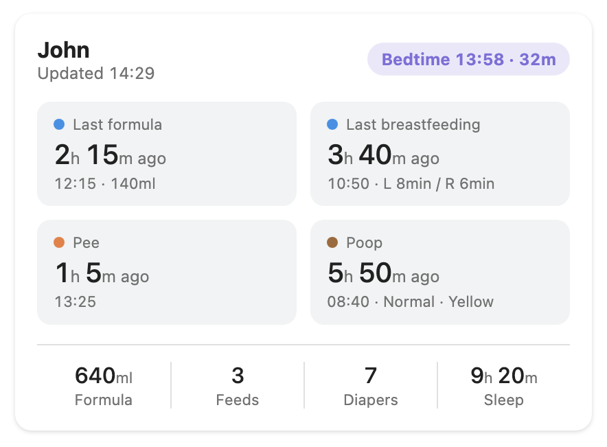
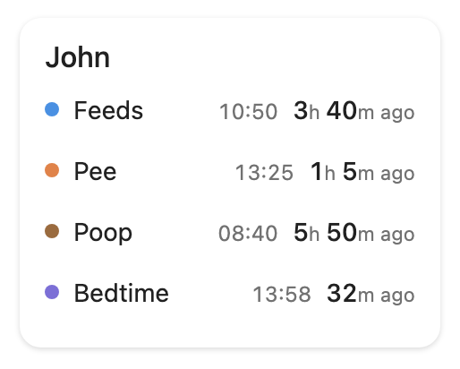
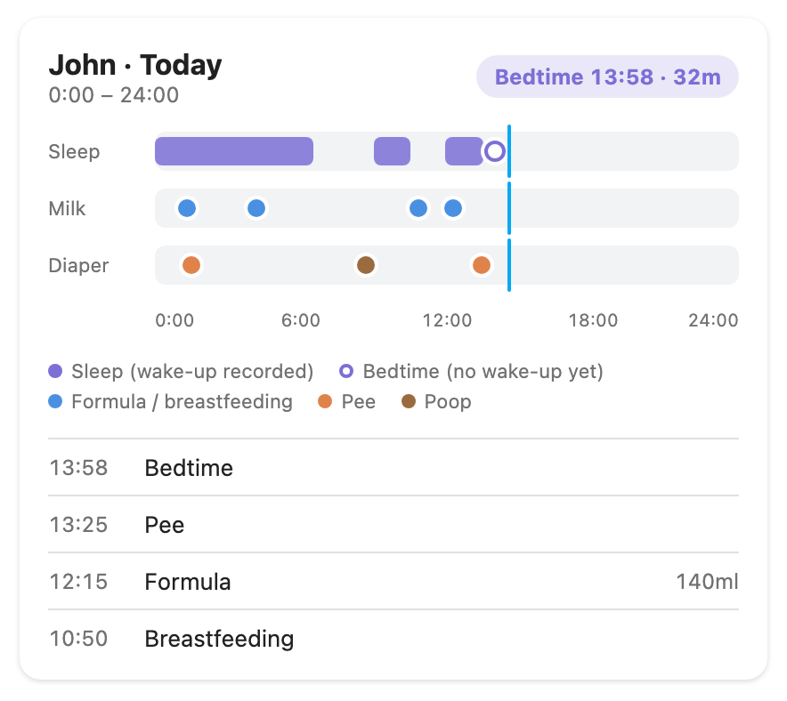
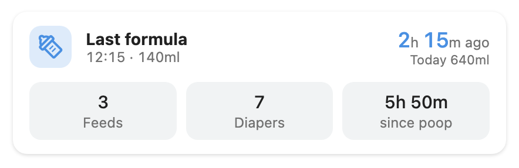
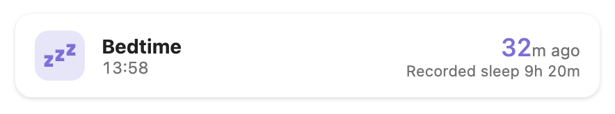

# ha-piyolog

[](https://github.com/s4k4tech/ha-piyolog/releases)
[](https://github.com/s4k4tech/ha-piyolog/actions/workflows/ci.yml)
[](https://github.com/s4k4tech/ha-piyolog/blob/main/LICENSE)
[](https://hacs.xyz)

English | [日本語](https://github.com/s4k4tech/ha-piyolog/blob/main/README.ja.md)

Home Assistant integration and dashboard cards for [PiyoLog](https://www.piyolog.com/) (a baby-care tracking app) data feeds.

> **Unofficial project.** This project is not affiliated with, endorsed by, or sponsored by PiyoLog.



*The summary card, with sample data. The other cards are shown under [Dashboard cards](#dashboard-cards).*

## Contents

- [Features](#features)
- [Requirements](#requirements)
- [Installation](#installation)
- [Setup](#setup)
- [Dashboard cards](#dashboard-cards)
- [Entities](#entities)
- [Automation example](#automation-example)
- [Troubleshooting](#troubleshooting)
- [Limitations](#limitations)
- [Security and privacy](#security-and-privacy)
- [Development](#development)

## Features

- Reads a PiyoLog [data feed](https://www.piyolog.com/app/piyolog/data_feed/en/index.html) and exposes the records as Home Assistant sensors.
- Shows the last formula, breastfeeding, pee, poop and sleep records at a glance, with the time since each.
- Four card types: summary, list, timeline and compact. You choose which items each card shows and in what order.
- Cards are served by the integration, so there is no dashboard resource to add.
- Follows Home Assistant's light and dark themes, in English and Japanese.
- Shows only what PiyoLog records and simple summaries of it (counts, totals, elapsed time). It does not predict or estimate anything, such as the next feeding time, and it never says that a child is asleep.

## Requirements

- A PiyoLog account with permission to create data feeds (account administrator).
- Home Assistant 2025.4 or newer. The integration runs on Home Assistant 2026.10 and its automated tests run against 2025.4.
- The free plan only offers a 24-hour feed. That is enough for this integration. Longer periods require PiyoLog Premium.

## Installation

### HACS (custom repository)

1. In HACS, open the menu and choose **Custom repositories**.
2. Add `https://github.com/s4k4tech/ha-piyolog` as an **Integration**.
3. Download **PiyoLog** and restart Home Assistant.

### Manual

Copy `custom_components/piyolog` into the `custom_components` folder of your Home Assistant configuration and restart.

## Setup

1. In PiyoLog, create a data feed and copy its URL.
2. In Home Assistant, go to **Settings → Devices & services → Add integration → PiyoLog**.
3. Enter the child's name and paste the feed URL. PiyoLog does not provide the name, so it is entered here.
4. Reload the browser tab once, so Home Assistant picks up the cards.

Add one entry per feed. The update interval (default 5 minutes, minimum 1 minute) can be changed in the integration's options.

## Dashboard cards

Add a card from the dashboard editor (search for "PiyoLog"), or in YAML. The visual editor lets you pick the device and reorder the items. The images below use sample data.

Every card takes these options:

```yaml
type: custom:piyolog-summary-card   # the card type, see below
device_id: <device id>              # pick it in the visual editor
name: John                          # optional, defaults to the device name
```

If there is only one PiyoLog device, `device_id` can be left out.

Time since a record ("2h 15m ago") is calculated in the browser from the record's time. Sleep is shown as the last Sleep or WakeUp record, for example "Bedtime 13:58 · 32m". The cards never say that a child is asleep.

For the lists below: items are shown in the order you write them. Leave an option out to show everything, or use `[]` to hide that part. An unknown item name shows a configuration error on the card.

### Summary card

`custom:piyolog-summary-card`


Time since the last formula, breastfeeding, pee and poop, today's totals, and the last sleep record.

| Option | Items |
|---|---|
| `tiles` | `formula`, `breastfeeding`, `pee`, `poop` |
| `totals` | `formula`, `breastfeeding`, `diapers`, `sleep` |

```yaml
type: custom:piyolog-summary-card
tiles: [poop, pee, formula]
totals: [formula, sleep]
```

### List card

`custom:piyolog-list-card`



A narrow list with one line per record. It shows the last breastfeeding, pee, poop and sleep by default.

| Option | Items |
|---|---|
| `items` | `breastfeeding`, `pee`, `poop`, `sleep`, `formula`, `today_formula`, `today_breastfeeding`, `today_diapers`, `today_sleep` (default: the first four) |

In a sections dashboard the card is 3 columns wide and 3 rows high, which sits next to Home Assistant's own entities cards. It grows taller when you add more than four items. Home Assistant's `grid_options` override the size:

```yaml
type: custom:piyolog-list-card
items: [breastfeeding, pee, poop, sleep]
grid_options:
  columns: 6
```

### Timeline card

`custom:piyolog-timeline-card`



Sleep, feeding and diaper records across today, plus the latest records.

| Option | Items |
|---|---|
| `rows` | `sleep`, `milk`, `diaper` |
| `legend` | `true` / `false`: the legend |
| `log` | `true` / `false`: the latest records |

```yaml
type: custom:piyolog-timeline-card
rows: [diaper, sleep]
legend: false
```

### Compact card

`custom:piyolog-compact-card`

One line for formula (`kind: formula`, the default) or sleep (`kind: sleep`).





| Option | Items |
|---|---|
| `kind` | `formula` or `sleep` |
| `quick` | `breastfeeding`, `diapers`, `poop_since` (for `kind: formula`) |

```yaml
type: custom:piyolog-compact-card
kind: formula
quick: [poop_since, diapers]
```

## Entities

Each feed becomes one device with these sensors.

| Entity | Description |
|---|---|
| Last formula | Time of the last formula record. Attribute: `amount_ml` |
| Last breastfeeding | Time of the last breastfeeding record. Attributes: `left_seconds`, `right_seconds`, `last_side`, `amount_ml` |
| Last pee | Time of the last pee record |
| Last poop | Time of the last poop record. Attributes: `amount`, `hardness`, `color` |
| Last sleep record | Time of the last Sleep record |
| Last wake-up record | Time of the last WakeUp record |
| Formula today | Sum of recorded formula amounts (ml) since local midnight. Records without an amount are not counted |
| Breastfeedings today | Number of breastfeeding records since local midnight |
| Diaper changes today | Number of pee and poop records since local midnight |
| Sleep today | Total of confirmed sleep intervals since local midnight |
| Timeline | Today's records, for use by the cards (diagnostic) |
| Last updated | When PiyoLog generated the data (diagnostic) |

Attributes that PiyoLog did not record are left out, never filled with zero. Memos are never exposed.

### How sleep is calculated

PiyoLog does not provide sleep durations. A sleep interval is counted only when a Sleep record is directly followed by a WakeUp record. If a WakeUp was never recorded, that period is not counted and the last record is shown as it is. The integration never claims that a child is asleep.

### What counts as "formula"

Only `Formula` records. Expressed breast milk, pumping and drinks are not included.

## Automation example

Notify when no formula was recorded for 4 hours (a plain elapsed-time check, not a prediction):

```yaml
triggers:
  - trigger: template
    value_template: >
      {{ (now() - states('sensor.john_last_formula') | as_datetime).total_seconds() > 4 * 3600 }}
actions:
  - action: notify.notify
    data:
      message: No formula has been recorded for 4 hours.
```

Replace `sensor.john_last_formula` with your entity ID.

## Troubleshooting

- **Cards do not appear, or "Custom element doesn't exist":** reload the browser tab (hard reload) after installing or updating. Wall-mounted tablets and kiosk apps such as Fully Kiosk Browser keep an old copy of the page, so clear their cache too.
- **"Feed not found" in setup:** check the URL is complete and the feed has not been revoked in PiyoLog.
- **Values look old:** PiyoLog caches feeds for 1 to 15 minutes. See [Limitations](#limitations).
- **Reauthentication request:** the feed returned 404 repeatedly. Create a new feed and enter its URL.
- **Sharing logs:** make sure they do not contain a feed URL. The integration does not log it.

## Limitations

- PiyoLog caches feeds for about 1 to 15 minutes, so new records can appear with a delay.
- A feed is a snapshot. Deleted records may remain until the cache refreshes.
- "Today" is based on the time zone configured in Home Assistant.
- The 24-hour feed only contains the last 24 hours. Totals for "today" are always covered by it.
- The integration only reads a feed. It does not write anything to PiyoLog.

## Security and privacy

A feed URL contains a secret and works as a credential. Anyone who has it can read the feed.

- Do not share it or commit it to a repository.
- The integration stores it in the config entry, masks it in the setup form, and never logs it or includes it in diagnostics.
- Home Assistant stores the URL unencrypted in its `.storage` folder, so be careful when sharing backups.
- If the URL leaks, revoke the feed in PiyoLog and create a new one. Home Assistant will ask for the new URL.

To report a vulnerability, see [SECURITY.md](https://github.com/s4k4tech/ha-piyolog/blob/main/SECURITY.md).

## Development

```bash
python3.13 -m venv .venv
.venv/bin/pip install -r requirements-dev.txt
.venv/bin/ruff check . && .venv/bin/ruff format --check .
.venv/bin/pytest
```

### Cards

The cards are written in TypeScript with Lit and live in `frontend/`. The built bundle is committed to `custom_components/piyolog/frontend/` so that HACS users do not need to build anything.

```bash
cd frontend
npm ci
npm run typecheck && npm test
npm run build   # rewrites the bundle; commit the result
```

To look at the cards without Home Assistant, serve the repository root (for example `python3 -m http.server`) and open `frontend/harness/index.html`. It uses a mock `hass` and a fixed clock. Useful query parameters: `?theme=dark`, `?lang=en`, `?list=1` (list card at its sections size), `?custom=1` (customised items) and `?card=summary` (one card on its own: `summary`, `list`, `timeline`, `compact-formula` or `compact-sleep`, as used for the screenshots).

See [CONTRIBUTING.md](https://github.com/s4k4tech/ha-piyolog/blob/main/CONTRIBUTING.md) for the contribution rules and [CHANGELOG.md](https://github.com/s4k4tech/ha-piyolog/blob/main/CHANGELOG.md) for the release history.

## License

[MIT](https://github.com/s4k4tech/ha-piyolog/blob/main/LICENSE)
